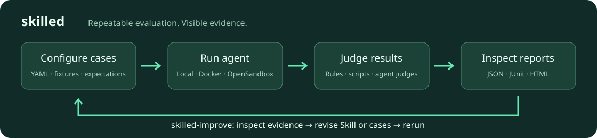

<p align="center"></p>

# skilled

Build repeatable checks for Agent Skills, agents and workspaces. Describe the task and expected behavior in YAML, choose an engine, and run the same cases locally or in an isolated environment. `skilled` records results as JSON, JUnit and HTML; `skilled-improve` helps your agent use those results to revise a Skill or strengthen its evaluations.



The CLI is **`skilled`**, and the improvement workflow is **`skilled-improve`**. Download version **0.1.0** from [GitHub Releases](https://github.com/DeadHead04/skillEd/releases/tag/v0.1.0). The CLI archives include Node and application dependencies, so you do not need Go, Node or npm to run an installed archive. Original copyright notices are retained under [Apache-2.0](LICENSE).

## Install the CLI

This repository is private. Install [GitHub CLI](https://cli.github.com/), sign in with an account that can access it, then install the versioned release:

```sh
gh auth login
installer_dir="$(mktemp -d)"
gh release download v0.1.0 --repo DeadHead04/skillEd --pattern install.sh --dir "$installer_dir"
SKILLED_USE_GH=1 SKILLED_VERSION=0.1.0 bash "$installer_dir/install.sh"
export PATH="$HOME/.local/bin:$PATH"
skilled --version
skilled --help
```

Add `export PATH="$HOME/.local/bin:$PATH"` to your shell startup file for future terminals. The installer detects your OS/CPU, downloads the matching archive, verifies its checksum, and installs a launcher. Windows PowerShell instructions, updates and removal are in the [installation guide](docs/guide/installation.md).

The familiar public installation command is supported when this repository is public:

```sh
curl -fsSL https://raw.githubusercontent.com/DeadHead04/skillEd/main/install.sh | bash
```

Anonymous `curl` cannot read private GitHub files; use the authenticated commands above while the repository is private. This CLI is distributed through GitHub Releases. Do not use `npm install -g skilled` from the public registry: this project has not published that registry name.

## Run your first evaluation

Configure your chosen engine/provider using the [user configuration guide](docs/guide/user-config.md), then run the installed command against your Skill's evaluations:

```sh
skilled init --print
skilled validate /path/to/my-skill/evals/eval.yaml
skilled run /path/to/my-skill/evals/eval.yaml --dry-run
skilled run /path/to/my-skill/evals/eval.yaml --format json --format html --format junit
```

`--dry-run` validates/selects cases without calling a model. The actual run requires the selected engine and provider credentials. To create the evaluation suite and improve the Skill through your agent, install [skilled-improve](skills/skilled-improve/README.md) and ask: “Use skilled-improve to evaluate this Skill, fix failures, add regression cases, and rerun.”

## Build and run locally

Use **Node 24.21.0** (see `.nvmrc`), npm and Git. Docker is needed for container checks. Authenticate Git for private repository access, or clone with `gh repo clone DeadHead04/skillEd`.

```sh
git clone https://github.com/DeadHead04/skillEd.git
cd skillEd
npm ci
npm run build
node dist/src/bootstrap.js --version
node dist/src/bootstrap.js --help
node dist/src/bootstrap.js validate examples/code-stats/evals/eval.yaml
node dist/src/bootstrap.js run examples/code-stats/evals/eval.yaml --dry-run
```

A real model-backed run needs a supported agent/provider account and its configured credentials. Keep credentials in environment variables or `~/.skilled/credentials.yaml`; do not put them into examples or reports. The example suite's `--dry-run` validates/selects cases without calling a model.

For an existing Skill, run:

```sh
node dist/src/bootstrap.js validate /path/to/skill/evals/eval.yaml
node dist/src/bootstrap.js run /path/to/skill/evals/eval.yaml --format json --format html --format junit
```

Automatic discovery supports `evals/eval.yaml` and Anthropic-style `evals/evals.json`. `run --baseline` compares with/without Skill configurations; `--iteration N` repeats N iterations, and the default appends the next numbered iteration. `--event-log /path/to/events.jsonl` writes structured lifecycle events. See the [CLI reference](docs/guide/cli-reference.md).

For archive extraction, PATH setup, npm tarballs, Windows, updates and removal, see [Installation](docs/guide/installation.md).

## Install a local archive

```sh
npm run package -- --target=darwin-arm64
node scripts/verify-package.mjs artifacts/skilled_0.1.0_darwin-arm64.tar.gz
```

Archives bundle Node, compiled code, production dependencies, assets and a launcher. Choose the target matching the machine. Build targets are Linux, macOS and Windows on x64/arm64; producing an archive does not establish native compatibility. Execution checks cover macOS arm64, Linux arm64 in Docker, macOS x64 through Rosetta and Linux x64 through Docker emulation. The release workflow separately checks native Linux, macOS and Windows archives before publication. Authenticated model combinations require provider credentials and remain outside those package checks.

Use the extracted archive's `skilled` launcher (`skilled.cmd` on Windows). Use the [release installation instructions](docs/guide/installation.md#install-from-github-releases) for prebuilt archives. Private downloads use GitHub CLI authentication; public downloads and mirrors use HTTP.

## Workflow and plugins

The canonical workflow is [skills/skilled-improve](skills/skilled-improve/SKILL.md). Build self-contained host bundles with:

```sh
npm run build
node scripts/package-plugins.mjs
```

Use the generated `dist/bundled-plugins/codex-skilled` or `dist/bundled-plugins/dsh-skilled` directory with the corresponding host's local plugin installation flow. See the [Codex plugin](plugins/codex-skilled/README.md) and [DSH plugin](plugins/dsh-skilled/README.md) instructions. Authenticated host sessions are separate from local installation checks.

## Repository structure

| Location | Contents |
| --- | --- |
| `src/cli`, `src/api` | CLI commands and embeddable execution entrypoint |
| `src/config`, `src/contracts`, `src/credentials`, `src/userconfig` | Schemas, decoding, validation and configuration |
| `src/runtime`, `src/platform`, `src/agent`, `src/mcp`, `src/skill` | Workspaces, processes, engine adapters and provisioning |
| `src/evaluator`, `src/judge`, `src/usersimulator`, `src/runner` | Case execution, grading, conversations and iteration orchestration |
| `src/report`, `assets` | Reports, templates, defaults and schemas |
| `src/events`, `src/observability`, `src/logging`, `src/ui` | Lifecycle events, telemetry and progress output |
| `plugins`, `skills`, `schemas` | Host integrations and shared workflow contracts |
| `tests`, `examples`, `docs`, `proposals` | Real checks, sample inputs, documentation and historical design records |

TypeScript compiles to ESM JavaScript. Serialized configuration/result fields keep their source names; internal APIs use promises, camelCase and `AbortSignal`. Go files inside the code-statistics fixture are deliberately retained **sample data**, not application runtime code.

## Verify changes

See [verification status](docs/verification.md) for the tested scope and remaining checks.

```sh
npm run typecheck
npm run test:real
npm run audit:brand
npm run docs:build
```

Tests use production functions, actual files/processes and configured services. Enable Docker with `SKILLED_DOCKER_INTEGRATION=1`; official engine installation checks use `SKILLED_ENGINE_INSTALL_INTEGRATION=1`. Run the cumulative gate with `npm run gate -- --phase=5`; evidence goes to `evidence/runs/`. A skipped service/device check is unverified, not a pass. [CONTRIBUTING.md](CONTRIBUTING.md) describes service setup and scope.

The tested OpenSandbox execd 1.0.16 loses stdout line separators in both implementations. Direct artifact downloads, case verdicts and reports are verified; glob-based artifact collection retains that upstream limitation. Local/Docker collection is tested. Live model calls require explicit credentials, provider/model selection and a spending limit.

## Documentation

- [Getting started](docs/guide/getting-started.md)
- [Writing evaluations](docs/guide/writing-evals.md) · [User configuration](docs/guide/user-config.md)
- [CLI reference](docs/guide/cli-reference.md) · [Migration](docs/guide/migration.md)
- [Code statistics example](examples/code-stats/README.md) · [DSH custom engine](examples/deepseek-harness/README.md) · [User simulator](examples/user-simulator/README.md)

`npm run docs:dev` starts the local English VitePress site. `npm run docs:build` writes static files under `docs/.vitepress/dist`; set `SKILLED_DOCS_BASE` when serving under a subpath. The [contribution guide](CONTRIBUTING.md) covers development checks; [CI maintenance](docs/guide/ci-maintenance.md) explains release verification and publication.
