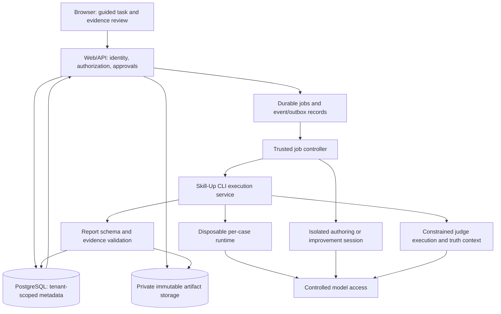

# SkillEd: backend, Skill-Up integration, permissions, and cloud readiness

Date: 2026-09-05. Checkout: `9ce0785`. Scope: current first-party application, relevant pinned Skill-Up implementation, running container metadata, deterministic CLI probes, product workflow, and cloud architecture requirements. This is an audit and improvement plan, not a deployment or a claim that every possible vulnerability has been ruled out.

## Assessment

**Keep Skill-Up as the execution and judging backend. The integration around it needs substantial work before unrelated customers can use this as a hosted service.**

The system currently combines a functioning local workbench skeleton with real Codex integration, explicit demo paths, incomplete evidence handling, and assumptions that only hold for trusted users sharing one machine. Putting the current Compose stack behind a public URL would not solve these problems.

Skill-Up itself is a CLI/library implementation, not a complete multi-tenant backend service. SkillEd must own authorization, immutable versions, durable work scheduling, sandbox provisioning policy, budgets, evidence storage, and user-facing decisions. Continue invoking the pinned CLI; do not import `skill-up/internal/*` into product code.

There are two separate readiness targets:

- **Private hosted pilot:** one trusted organization/installation, restricted access, bounded execution, recoverable state, correct results, and a supported automation identity.
- **Public customer service:** separate customer ownership and authorization, isolated execution and credentials, quotas, onboarding, deletion/retention, operational support, and validated provider access. These are additional product requirements, not existing features hidden behind configuration.

“Codex runs in the cloud” needs precise wording: this application launches Codex CLI/App Server inside its worker environment. Model inference is remote; command execution currently uses Skill-Up's `none` runtime inside that worker container. It is not invoking OpenAI's managed Codex cloud execution service.

## Evidence collected

| Check                                                | Observation                                                                                                                         | Interpretation                                                                                                  |
| ---------------------------------------------------- | ----------------------------------------------------------------------------------------------------------------------------------- | --------------------------------------------------------------------------------------------------------------- |
| Preflight                                            | Passed with Docker socket access                                                                                                    | Compose/configuration prerequisites are present; not proof of sandbox readiness                                 |
| Worker source comparison                             | Four inspected worker/core files match checkout hashes                                                                              | Findings in those files apply to the current worker image                                                       |
| Worker identity                                      | UID/GID 0                                                                                                                           | Application worker is root                                                                                      |
| Container restrictions                               | Not privileged; writable root filesystem; no explicit capability drops/security options; memory/CPU limits zero and PID limit unset | Some Docker defaults apply, but application-specific hardening and resource budgets are missing                 |
| Runtime tools                                        | Python 3.11.2; no Go or Docker executable                                                                                           | UI's Python 3.12/Go readiness claim is incorrect; Docker runtime is not ready to use inside this image          |
| Sandbox probe                                        | `codex sandbox linux --help` returned a bwrap namespace-permission error                                                            | Sandbox helper invocation fails in the present container; no model call or bypass was attempted                 |
| Mounts                                               | Shared writable artifacts/work volumes; only the Codex authentication file is bind-mounted                                          | Conversation/session files elsewhere under Codex home do not persist across container replacement               |
| Database role                                        | Application role is superuser, can create databases and roles                                                                       | Not least-privilege credentials for a hosted application                                                        |
| Current run metadata                                 | 3 completed demo runs; 6 completed and 1 failed runs with unknown adapter                                                           | Historical completed runs cannot all be treated as verified real evidence; unknown is not proof of fake or real |
| Unit suite                                           | 26/26 pass                                                                                                                          | Existing tests miss important integration contracts                                                             |
| Previous review checks on unchanged application code | Type checks, formatting, production web build, and real-mode stack health passed                                                    | Build/health checks are not acceptance tests                                                                    |
| Real script judge                                    | Exact synthetic check returns PASS with assertion text `script: <path>`                                                             | This is the actual pinned backend's script assertion contract                                                   |
| SkillEd ingestion of that contract                   | PASS becomes ERROR because script assertion text is unmapped                                                                        | Confirmed integration defect                                                                                    |
| Missing grading / missing required dimension         | Both can normalize to PASS                                                                                                          | Confirmed in database-free ingestion probes in the initial review                                               |
| ZIP permission round trip                            | Synthetic executable mode changes 0755 → 0644                                                                                       | Confirmed package integrity defect                                                                              |
| Full deterministic Skill-Up run                      | 4 cases × 2 configurations × 2 iterations; 16 output files collected                                                                | Fixtures, script judging, baselines, repetition, and artifact collection work in the pinned CLI                 |
| Full-run negative cases                              | Exact mismatch FAIL; validator crash FAIL; judge timeout FAIL                                                                       | Backend FAIL semantics need adaptation before claiming infrastructure/correctness separation                    |
| Debug timeout probe                                  | Debug judge ignored configured 1s timeout; a 3s script completed PASS                                                               | Debug constructor omits timeout; normal run did enforce 1s. Do not generalize the debug result to normal runs   |
| Browser                                              | Login screen inspected; no signed-in browser session available                                                                      | Authenticated workflow conclusions are from source and historical screenshots, not a new full browser journey   |

Synthetic probes used temporary files and a deterministic custom local engine, with no model calls. The full CLI probe used an explicit minimal environment and did not receive the worker's credentials. Production records, authentication files, container configuration, and running worker mode were not changed. No sandbox protection was disabled.

The full CLI run exited 1 because intentionally failing cases were included. This is expected; **a nonzero CLI exit alone is not sufficient to classify the entire run as infrastructure failure**. Validate reports and classify each outcome.

## Skill-Up capabilities versus SkillEd integration

| Capability in pinned Skill-Up              | SkillEd today                                                              | Work needed                                                                                     |
| ------------------------------------------ | -------------------------------------------------------------------------- | ----------------------------------------------------------------------------------------------- |
| Declarative YAML and `validate`            | Real CLI call for initial generation                                       | Also validate edits/derived evals; enforce application policy beyond syntax                     |
| Case listing/subsetting                    | Primarily DB case list; bundle is executed as stored                       | Bind enabled/selected cases to the exact execution specification                                |
| Skill installation                         | Real, with upstream exclusion of `evals/`                                  | Preserve executable bits; audit all instruction/config files; verify bytes                      |
| Context files and repository fixtures      | Uploaded materials available to author; no generated per-case file staging | Emit approved input fixtures into `context.files` / `repo_fixture`                              |
| Rule-based checks and expect checks        | Not exposed by generation schema                                           | Expose safe structured rules for exact invariants                                               |
| Script judges                              | Generated exact-text Python checks                                         | Fix assertion mapping; add artifact checks and explicit validator error envelope                |
| Agent judges and judge context/attachments | Agent criteria used; evidence context not fully configured                 | Ground judges with permitted authority/expected outputs and preserved artifact references       |
| Baselines                                  | API/real runner supports them; UI disables; demo ignores                   | User controls, separate configuration displays, complete sample checks                          |
| Repeated trials                            | API allows 1–3; launch/verification UI uses 1                              | User choices; stable configuration grouping; verification policy                                |
| Multi-turn cases                           | Upstream supports them                                                     | Not in current generated schema; audit resume sandbox behavior before exposing                  |
| Artifact selection and transcripts         | Reports requested; standalone outputs not persisted by SkillEd             | Use collection patterns and a complete, safe artifact manifest                                  |
| JSON/HTML/JUnit/benchmark formats          | Raw JSON/HTML subset                                                       | Preserve authoritative schema; selectively expose useful exports                                |
| `none`, `docker`, `opensandbox` runtimes   | Hardcoded `none`                                                           | Deployment-specific runtime adapter, security policy, compatible images, cleanup/reconciliation |
| MCP/mock tool environments                 | Generated server list is empty                                             | Explicit future capability requiring credentials, egress, ownership, and side-effect policy     |
| Other engines/custom transport             | Product forces Codex                                                       | Useful internal testing seam; expose to customers only with a defined support/security contract |
| Retry and timeout mechanics                | Partial configuration plus coarse ingestion                                | Distinguish infra retries, judge-format repairs, correctness failures, cancellation, and cost   |
| Telemetry/user configuration               | Vendored auto-discovery remains active                                     | Prevent uploaded config from controlling trusted orchestration/export destinations              |
| Import existing evals                      | CLI supports import                                                        | Current product strips package evals and has no import/review flow                              |

Key upstream references: `skill-up/internal/config/schema.go`, `internal/evaluator/fixtures.go`, `internal/evaluator/artifacts_collect.go`, `internal/judge`, `internal/runtime`, and `internal/agent/skill.go`.

## What is real, mocked, hardcoded, or absent

| Area                                                          | Classification                       | Details                                                                                        |
| ------------------------------------------------------------- | ------------------------------------ | ---------------------------------------------------------------------------------------------- |
| Upload/storage/users/jobs/API/UI                              | Real implementation                  | Not an all-mock frontend                                                                       |
| Codex authoring and proposal generation                       | Real in non-fake mode                | Structured App Server calls; operational durability/permissions are incomplete                 |
| Skill-Up execution                                            | Real in non-fake mode                | Child process invokes installed CLI                                                            |
| Fake understanding and plan                                   | Explicit mock                        | Fixed product-QC-oriented content; even default understanding is product-specific              |
| Fake results                                                  | Explicit mock                        | Case ID prefixes and candidate status determine result; no agent/judge execution               |
| Fake tokens/durations/responses                               | Explicit mock                        | Fixed numbers/formulas and canned responses                                                    |
| Fake improvement                                              | Explicit mock                        | Appends a fixed grounding section; candidate status makes fake results pass                    |
| Fake baseline                                                 | Missing                              | Fake runner only emits Skill configuration even when baseline is requested                     |
| Initial generated suite validation                            | Real validation, including fake mode | Calls Skill-Up; does not prove task correctness                                                |
| Derived eval validity                                         | Hardcoded assertion                  | Stored as valid without rerunning Skill-Up validation                                          |
| Package readiness                                             | Hardcoded assertion                  | Runtime/dependency findings are not derived from checks                                        |
| “App Server ready”                                            | Inferred                             | Based on login text, not protocol or sandbox test                                              |
| Evidence strength                                             | Heuristic metadata                   | File categories can mark evidence Grounded/Strong before assessing its actual content/coverage |
| Maximum cases                                                 | Hardcoded policy                     | Five cases; not a Skill-Up limitation                                                          |
| UI launch/verification settings                               | Hardcoded                            | One iteration, fixed model; launch has no baseline                                             |
| Structured eval revisions via chat                            | Incomplete                           | Message path returns conversational text, not updated coverage/case state                      |
| Full file/artifact inspector, rollback, creation from scratch | Absent                               | Required for broader easy-use product, not current ZIP-only workflow                           |
| Tenant isolation, budgets, retention, self-service access     | Absent                               | Current accounts share the installation                                                        |

Keep deterministic adapters for tests and demos, but isolate demo data and execution mode. Persist provenance in exports as well as UI; a badge alone cannot protect downloaded evidence from being misunderstood.

## Findings and improvement backlog

Priorities: **P0** blocks truthful evaluation or execution of untrusted customer workloads; **P1** blocks dependable product use or hosted operation; **P2** improves supportability/usability after those gates. Evidence: **R** reproduced/observed; **S** source-confirmed; **D** design requirement or risk that still needs targeted verification. Related findings are grouped to avoid treating symptoms as unrelated tickets.

### Evaluation, versioning, and the Skill-Up contract

| ID  | Priority / evidence | Gap and consequence                                                                                                                                                                        | Fix and acceptance condition                                                                                                                                                                                                                                   |
| --- | ------------------- | ------------------------------------------------------------------------------------------------------------------------------------------------------------------------------------------ | -------------------------------------------------------------------------------------------------------------------------------------------------------------------------------------------------------------------------------------------------------------- |
| E01 | P0 / R              | Missing grading, missing required assertions, and empty arrays can produce PASS. `runner.ts:388`, `results.ts:10`.                                                                         | Validate the entire grading schema and required assertion/dimension set; absent, duplicate, malformed, or unmapped evidence becomes ERROR. Test FAIL-without-grading and missing-scope cases.                                                                  |
| E02 | P0 / R              | Skill-Up script assertions are `script: <path>`, but generated manifests map dimension criteria. Valid script PASS becomes ERROR. `runner.ts:388`, upstream `judge/script.go:buildResult`. | Add a versioned script-result adapter with stable assertion IDs and explicit per-dimension results. Run real CLI script outputs through the same ingestion code in tests.                                                                                      |
| E03 | P0 / R+S            | Script crash and timeout become FAIL upstream. Blindly copying FAIL cannot meet SkillEd's promise to distinguish judge infrastructure from task correctness.                               | Define validated script evidence with task-failure versus validator-error categories; preserve raw status/error and normalize conservatively. Tests must cover assertion failure, exception, timeout, missing interpreter, and invalid evidence.               |
| E04 | P0 / S              | Missing later iteration reports, empty results, and incomplete case/configuration coverage can still complete a run. `runner.ts:304–364`.                                                  | Validate expected execution matrix, unique rows, configurations, iteration numbers, and report schema. Preserve available evidence and end as ingestion error when incomplete. Handle documented CLI exits rather than treating all nonzero exits identically. |
| E05 | P0 / S              | Approved cases can mutate; PATCH changes DB metadata without rebuilding the executed bundle. Author endpoint can restart approved versions. API `route.ts:446,910`.                        | Approved artifacts and metadata are append-only. Edit by cloning a new draft, rebuild/validate, then separately approve it. API and DB-level tests reject in-place mutation.                                                                                   |
| E06 | P0 / S              | A changed uploaded ZIP immediately replaces the active version. API `route.ts:416`.                                                                                                        | Only bootstrap an initial version automatically if policy permits. Later versions stay inactive/candidate until explicit verified activation.                                                                                                                  |
| E07 | P0 / S              | Verification compares overall labels only, ignores required-dimension regressions, and can accept an empty comparison. `runner.ts:140`.                                                    | Compare case × configuration × iteration/dimension coverage, block missing evidence and new required failures, and test FAIL→FAIL with a newly broken scope dimension.                                                                                         |
| E08 | P1 / S              | Uploaded datasets/documents do not reach tested cases as files. Generated input contains only prompt; bundle has no task fixtures. `evals.ts:660,753`.                                     | Stage approved test inputs separately from judge-only truth; include content hashes and explicit file mappings. A workbook test must execute against the uploaded workbook and return a verifiable workbook.                                                   |
| E09 | P1 / S              | Generated scripts judge final text only, despite UI claims about exact artifact checks. `evals.ts:693`.                                                                                    | Support typed artifact assertions, selected worksheet/cell/schema checks, protected-field comparisons, and validated output existence. Never replace task execution with the validator.                                                                        |
| E10 | P1 / S              | Derived eval patches skip Skill-Up validation and map criteria positionally; script criteria edits do not rewrite script behavior. API `route.ts:710–806`.                                 | Validate exact derived suite and assertion map. Retain original eval binding separately from verification eval. Explicitly explain any coverage change before approval.                                                                                        |
| E11 | P1 / S              | Retry upsert changes only `source`, retaining old judge/mapping/metadata; removed case rows can remain. `evals.ts:680`.                                                                    | Regenerate a draft revision atomically with an exact case set; no stale rows or phantom enabled cases. Failed generation cannot partially overwrite the next approvable state.                                                                                 |
| E12 | P1 / S              | Case disabling/source editing is disconnected from YAML execution. Progress may count one set while Skill-Up runs another.                                                                 | Materialize the selected case set into the immutable run spec or use verified CLI selection; tests assert launched and reported case IDs match.                                                                                                                |
| E13 | P1 / S              | Run launch accepts arbitrary Skill/eval UUIDs without confirming same package or supported version relationship. API `route.ts:558`.                                                       | Validate ownership, package relationship, approval, readiness, and selection atomically; support base/candidate compatibility explicitly.                                                                                                                      |
| E14 | P1 / S              | Checksums are recorded, not recomputed before use; upload checksum describes original ZIP rather than normalized installable bytes.                                                        | Store original and installable digests separately, verify all artifacts immediately before execution, and bind image/CLI/schema/model/policy versions into a run manifest.                                                                                     |
| E15 | P1 / R+S            | Baseline rows are folded into Skill scores and counted as flakiness. `data.ts:summary`, run page aggregation.                                                                              | Stability is within configuration across trials; baseline benefit is a separate comparison. A stable with-Skill PASS / without-Skill FAIL must not display as a flaky Skill failure.                                                                           |
| E16 | P1 / S              | Standalone outputs/transcripts are omitted from SkillEd's bundle before work directory deletion. `runner.ts:349–374`; case artifact fields remain empty.                                   | Upload safe collected artifacts, transcripts, grader evidence, and manifests before cleanup. Keep partial-run downloads available with explicit status.                                                                                                        |
| E17 | P1 / S              | Completed proposal verification runs that fail/cancel can leave proposal verifying forever. Comparison settings are fixed to one trial.                                                    | Resolve every terminal child outcome; configurable matched verification settings; no activation while evidence is incomplete.                                                                                                                                  |
| E18 | P1 / S              | Five-case truncation can silently diverge from approved plan; demo plan has ten planned cases. Iteration rationale is not enforced.                                                        | Make coverage/cost limits visible before approval. Reject incompatible plans or request a reviewed revised plan; never silently drop required coverage.                                                                                                        |
| E19 | P1 / S              | Prompt/criteria provenance is free text, not references to stable material IDs/locations. Criteria count can differ from dimensions; duplicate text collapses maps.                        | Stable assertion IDs, explicit dimensions, source hashes/locations, rubric versions, and coverage validation. Add known-good and known-bad calibration outputs.                                                                                                |
| E20 | P2 / S              | Real-test wrapper uses unsupported `--iterations` and defaults to a relative eval path; debug judge ignores configured timeout.                                                            | Fix wrappers against pinned CLI help, supply deterministic fixtures, and separate CLI debug smoke from full normal-run contract tests.                                                                                                                         |

### Intake, artifacts, and improvement integrity

| ID  | Priority / evidence         | Gap and consequence                                                                                                                                                                                                        | Fix and acceptance condition                                                                                                                                                                                                                                                |
| --- | --------------------------- | -------------------------------------------------------------------------------------------------------------------------------------------------------------------------------------------------------------------------- | --------------------------------------------------------------------------------------------------------------------------------------------------------------------------------------------------------------------------------------------------------------------------- |
| I01 | P1 / R                      | ZIP extraction loses executable bits (0755→0644). `archive.ts:extractZip`.                                                                                                                                                 | Preserve safe regular-file executable modes while rejecting special files and dangerous mode bits; downloaded/reinstalled helpers remain runnable.                                                                                                                          |
| I02 | P1 / S                      | Multipart completion waits for parser finish, not destination file-write completion; writer errors/early cleanup are incomplete. API `route.ts:40`.                                                                        | Await each pipeline; clean temporary files on parse, stream, abort, limit, and disk failures. Large synthetic upload tests prove no truncated reads.                                                                                                                        |
| I03 | P0 for public intake / S    | Material kind is a free string later used in filesystem paths. `route.ts:418–431`, `evals.ts:78`.                                                                                                                          | Enum-validate categories; resolve every staged path under a per-job root. Reject path separators/escapes before writes.                                                                                                                                                     |
| I04 | P1 / S                      | Same ZIP dedup returns before recording newly supplied task description/materials; user cannot start a fresh task around unchanged Skill through this path. Global checksum also ignores selected root.                    | Separate package version identity from task/eval creation. Reuse bytes while creating a new task context; include selected root/canonical package identity.                                                                                                                 |
| I05 | P1 / S                      | Frontmatter is parsed by regex; missing names collapse to “Uploaded Skill”; new version identity is inferred from global name, not selected package.                                                                       | Validate package format and explicit target package/version lineage. Handle quoted/multiline fields correctly.                                                                                                                                                              |
| I06 | P0 for public execution / S | Installable exclusions are not a full control-file/secret policy; original ZIP is retained and staged for authors. Uploaded `.skill-up.yaml` remains eligible for trusted CLI discovery because run cwd is the Skill root. | Treat all uploads as untrusted, quarantine/reject prohibited content, and isolate original inspection. Run orchestration from trusted cwd with sanitized configuration/environment; do not allow package content to choose telemetry/export destinations or service policy. |
| I07 | P1 / S                      | Proposed patch view is complete replacement content prefixed with `+`, not a real before/after diff. No delete/rename support; candidate metadata/readiness are copied.                                                    | Compute real diff from immutable base, label supported operations, validate actual candidate frontmatter/files/runtime requirements, and reject ambiguous changes.                                                                                                          |
| I08 | P1 / S                      | Candidate creation, version allocation, artifact publication, and proposal decisions are not one consistent transaction; concurrent decisions can race or strand artifacts.                                                | Idempotent operation key, resource lock/revision check, staged artifact publication, transactional metadata commit, and orphan reconciliation.                                                                                                                              |
| I09 | P1 / S                      | ArtifactStore overwrites existing keys by rename; immutability depends entirely on callers. No retention/deletion/backup workflow.                                                                                         | Content-addressed immutable objects, ownership-scoped metadata, write-once semantics, retention policy, restore tests, and deletion audit.                                                                                                                                  |
| I10 | P1 / S                      | Uploads/bundles/reports are read into memory; raw logs grow unbounded; limits are per-file rather than whole account/job.                                                                                                  | Aggregate upload/expanded-byte/entry/storage/output budgets, streamed storage/downloads, bounded logs, and backpressure.                                                                                                                                                    |

### Jobs, state, and operations

| ID  | Priority / evidence | Gap and consequence                                                                                                                                           | Fix and acceptance condition                                                                                                                                                                                        |
| --- | ------------------- | ------------------------------------------------------------------------------------------------------------------------------------------------------------- | ------------------------------------------------------------------------------------------------------------------------------------------------------------------------------------------------------------------- |
| O01 | P1 / S              | Recovery only checks expired running leases at startup. A fast restart before expiry strands the job. `index.ts:82`.                                          | Periodic lease reconciliation with clear fencing and interruption policy. Crash/restart before and after lease expiry must terminate or safely resume the owner resource.                                           |
| O02 | P1 / S              | Worker identity uses PID, and `busy` is only process-local. Replicas can share IDs and claim conflicting resource jobs.                                       | Unique instance IDs, per-resource serial execution, fenced writes, claim concurrency limits, and tenant/account fairness. Scale only after concurrent-worker tests.                                                 |
| O03 | P1 / S              | Resource state updates and enqueue are often separate commits; retries and repeated requests can duplicate work.                                              | Transactional outbox or atomic resource/job creation; idempotency keys and unique active-operation constraints. Test disconnect immediately after acceptance.                                                       |
| O04 | P1 / S              | Cancellation signals only the Skill-Up child; worker has no shutdown drain handler; queued cancellation can still launch work.                                | Cancel before spawn; signal/reap the complete process tree or destroy the per-job sandbox; graceful worker shutdown with bounded deadline and durable terminal events.                                              |
| O05 | P1 / S              | Real cancellation can leave job completed while run cancelled; unexpected child errors can skip timer cleanup.                                                | One authoritative terminal outcome propagated consistently; timers/resources always cleaned in finally; cancellation remains distinct in reports and UI.                                                            |
| O06 | P1 / S              | App Server RPC requests have no general timeout; turn completion handler is registered after start response; spawn errors and resume fallback are incomplete. | Bounded RPCs, buffered early notifications, child error handling, explicit interruption, serialized conversation access, and resume/reconstruct policy. Inject protocol failures without calling models.            |
| O07 | P1 / R+S            | App Server thread data lives in non-persistent Codex home except authentication mount. DB thread IDs cannot reconstruct missing native threads.               | Persist isolated authorized conversation state or rebuild a new thread from durable completed messages/summary with explicit provenance. Test container replacement, not merely process restart.                    |
| O08 | P1 / S              | Author/proposal workspaces persist without lifecycle cleanup; uploaded previews load whole text before slicing; stalled operations consume shared disk.       | Explicit retained-session workspace policy and per-tenant limits; safe janitor reconciles orphaned workspaces. Stream/limit previews and document what is retained.                                                 |
| O09 | P1 / S              | Health says ready based on heartbeat age; login is used as proxy for App Server; artifacts are not truly probed; observed sandbox failure is invisible.       | Separate liveness from readiness: DB, writable storage, protocol, supported model/auth, sandbox start/stop, queue backlog. Include sanitized failure reason and block incapable work.                               |
| O10 | P1 / S              | “Migrations” rerun whole schema including FK drop/add; no serialized versioned migrator.                                                                      | One migration job, ordered migrations, separate migration role, rollback/roll-forward and backup restore procedure. App runtime never needs DDL privileges.                                                         |
| O11 | P1 / S              | DB status strings/state helper are not enforced together; many workflow steps bypass the tested state machine.                                                | Central transition service with revision locks and database constraints where feasible. Negative transition tests must exercise production API/worker code.                                                         |
| O12 | P2 / S              | Missing common FK/query indexes and pagination; N+1 sidebar queries; SSE polls every 500ms per connection and reconstructs full history.                      | Query plans under representative load, batched summaries, pagination, bounded event replay and retention, delivery backpressure. PostgreSQL jobs can remain initially; another queue is not automatically required. |
| O13 | P1 / S              | Generated artifacts and source mode are not fully pinned per job; worker-wide fake/real selection and fixed model choices can change evidence semantics.      | Persist adapter/auth/runtime/model/judge policy in immutable run/job manifests. Demo cannot silently become real or certify an active customer candidate.                                                           |
| O14 | P1 / S              | CI has no full lifecycle fixture journey and relies on pre-existing package fixtures. Health loop accepts any HTTP success.                                   | Start a disposable clean database with valid explicit test configuration and no personal credentials; seed through APIs; run complete lifecycle and negative scenarios; assert readiness JSON.                      |

### Container, permissions, authentication, and cloud blockers

| ID  | Priority / evidence               | Gap and consequence                                                                                                                                                   | Fix and acceptance condition                                                                                                                                                                                                                 |
| --- | --------------------------------- | --------------------------------------------------------------------------------------------------------------------------------------------------------------------- | -------------------------------------------------------------------------------------------------------------------------------------------------------------------------------------------------------------------------------------------- |
| C01 | P0 / R                            | Current sandbox helper fails with namespace permission error.                                                                                                         | Validate the exact pinned CLI in the chosen runtime. A failing sandbox is a hard readiness failure. Do not solve it by disabling sandboxing in the shared worker.                                                                            |
| C02 | P0 / R+S                          | Root worker, shared writable artifacts/work, same-container runtime `none`, no job-level resource bounds.                                                             | Separate trusted controller from disposable execution; non-root identities, restricted mounts, immutable base image, CPU/RAM/PID/disk/output/time quotas. Test hostile synthetic workloads only in an isolated test environment.             |
| C03 | P0 / R+S                          | Worker DB credentials are inherited through child environment; upstream none-runtime starts from process environment. DB role is superuser.                           | Tested code/judges never receive DB/admin credentials. Use minimal env, separate service roles, scoped artifact access and short-lived execution grants. Test with synthetic secret markers, never actual credentials.                       |
| C04 | P0 for multi-customer hosting / S | No tenant ownership on Skills/evals/runs/jobs/events/artifacts; operators access shared data by design.                                                               | Server-verified tenant context on every path, worker job, download, and event stream; composite relationships and scoped uniqueness; isolation tests. Keep shared access only for explicitly private single-tenant installation.             |
| C05 | P0 for public execution / S       | New directory / workspace-write is not a demonstrated credential, sibling-file, or judge-truth read boundary.                                                         | Enforce permitted reads as well as writes in an external isolation boundary. Test workspace, sibling, home, credential-marker, metadata-service and network denial. Fresh conversation is not filesystem isolation.                          |
| C06 | P0 for public execution / S       | No service-level egress policy. Model traffic, package setup, telemetry, user code, and private DB share a network environment.                                       | Distinguish model-provider egress from tool egress; restrict arbitrary destinations, private networks and cloud metadata. A model connection must work without granting uploaded code unrestricted internet.                                 |
| C07 | P1 / S                            | Skill-Up Docker runtime is not a drop-in cloud hardening switch: needs Docker access, lacks configured resource/security flags, and rejects allow-declared egress.    | Use a dedicated orchestrator/isolated execution service; do not mount the host Docker socket into the user-code worker. Validate runtime behavior and provider constraints before choosing it.                                               |
| C08 | P1 / S                            | OpenSandbox support is present but not provisioned, authenticated, limited, or tested here.                                                                           | Evaluate remote sandbox service separately: API authorization, tenant boundary, image policy, quotas, egress enforcement, artifact transfer, timeouts and orphan cleanup. Support in source is not deployed capability.                      |
| C09 | P1 / S                            | Remote runtime installation can use upstream Codex default 0.80.0 while current image pins 0.149.0-alpha.4.1.                                                         | Version-compatible prebuilt runner image and controlled install behavior. Verify no runtime downgrade or unapproved dependency download.                                                                                                     |
| C10 | P1 / S                            | Upstream resume command uses bypass-sandbox flag; normal SkillEd generated cases are single-turn, but multi-turn/agent-judge correction can exercise resume behavior. | Audit the pinned resume paths and external sandbox containment before enabling more capabilities. Do not infer unrestricted execution solely from a flag without testing the outer boundary.                                                 |
| C11 | P1 / S                            | Shared human Codex login has one budget, refresh lifecycle, and no customer accounting.                                                                               | Choose a supported private automation or API-funded execution model, pin compatibility with the installed CLI, implement metering and reauthentication. Do not presume the App Server OAuth surface is a general customer OAuth integration. |
| C12 | P0 for public hosting / S         | Compose contains development defaults; secure cookies depend on an extra env flag not wired into current Compose; login accepts protocol-relative `next` URLs.        | Fail closed on default secrets, configure HTTPS/session behavior explicitly, validate redirect same-origin, harden login throttling/identity recovery, and verify edge/proxy configuration.                                                  |
| C13 | P1 / S                            | Workflow approvals/activations lack actor audit and stale-base checks; old verified proposals can be activated again via API.                                         | Record actor/revision/input digests for every decision. Compare expected active version on activation; make repeated requests idempotent and superseded activation explicit.                                                                 |
| C14 | P1 / S                            | No published data lifecycle, deletion, export ownership, key rotation, cost budget, abuse controls or customer support telemetry.                                     | Before public pilot define and implement each; separate user data from operational logs and support access. Test tenant offboarding and restore.                                                                                             |
| C15 | P1 / S                            | Build image tags are mutable; Docker installs use non-frozen lockfiles; Skill-Up binary identifies itself as dev.                                                     | Pin image digests/lockfiles, inject source version, generate dependency inventory, scan release images, and test dependency upgrades against adapter fixtures.                                                                               |

The current worker is **not privileged** and does **not** mount a Docker socket. Those are good existing boundaries to preserve. The absence of explicit security options does not mean Docker applies no default isolation; it means current defaults have not met the application's required execution/security contract, and one sandbox probe already fails.

### User journey gaps

| ID  | Priority | Current obstacle                                                                                                              | Required user experience                                                                                                                                                    |
| --- | -------- | ----------------------------------------------------------------------------------------------------------------------------- | --------------------------------------------------------------------------------------------------------------------------------------------------------------------------- |
| U01 | P1       | ZIP-only input requires the user to know how to author/package a Skill                                                        | Keep upload; add a guided “Create from task” flow producing a reviewable draft Skill, sample materials, and package validation. This is new scope, not a current capability |
| U02 | P1       | Existing run hides launch controls; Configure run opens latest results                                                        | Dedicated new-run route, explicit Skill/eval selection, rerun action, baseline/trial presets and cost estimate                                                              |
| U03 | P1       | No independent fresh eval creation for unchanged Skill; no add/remove/reclassify task materials after intake                  | New task/eval action and versioned material management with concrete source previews                                                                                        |
| U04 | P1       | Case review is a metadata table; no full prompt, criteria, fixture, YAML, validator or provenance inspector                   | Plain-language case summary with expandable exact evidence and safe structured editing                                                                                      |
| U05 | P1       | Authoring chat revisions don't update structured plan/cases                                                                   | “Propose revision” creates an explicit draft diff and invalidates previous approval when needed                                                                             |
| U06 | P1       | Navigation/remount loses local JobStream job ID; generating proposal screen has no durable subscription                       | Recover active job from DB, resume progress after refresh, actionable error/retry/cancel for every long stage                                                               |
| U07 | P1       | Results show response text, not drill-down assertion/transcript/artifact evidence; PARTIAL text always says scope failed      | Show actual failing dimensions, grader evidence, output previews and separate Skill/baseline/trial views                                                                    |
| U08 | P1       | Proposal diff isn't a true diff; no version history/rollback controls or safe stale-candidate handling                        | Actual before/after diff, independent Skill/eval approval, clearly bound source run, candidate download and explicit verified version selection                             |
| U09 | P2       | Fetch handlers generally lack catch/finally; disconnects can leave buttons busy; account setup/recovery is administrator-only | Recoverable network errors and pending-state persistence; for hosted use, invitation/sign-in/help flows appropriate to chosen identity provider                             |
| U10 | P2       | Fixed jargon-heavy QC examples and oversized historical case tables are poor onboarding for unrelated tasks                   | Explain “Skill”, “eval”, “baseline”, and “judge” in task language; offer a few real templates and progressive disclosure; preserve exact versions and status text           |

Historical screenshot `docs/screenshots/desktop-evals.png` shows a 38-case suite in a very long page, while the current generator caps cases at five. It is useful for layout critique, not proof of current generation capability. In that historical screenshot, the three main issues are dense case metadata, approval far below the initial task understanding, and absence of an obvious exact-case evidence inspector. Preserve the structured understanding and visible version context; remove repeated metadata text from each collapsed row. Historical screenshot-only rubric: decision clarity 3/5, evidence hierarchy 3/5, state truth 3/5, visual identity 4/5, restraint 3/5, typography 3/5, accessibility 2/5 (keyboard/contrast not tested), responsive credibility 2/5 (not established from desktop): 23/40. This is not a current authenticated UI certification.

## Recommended backend boundaries

The boundaries describe a target, not a requirement to create a dozen microservices. The web/API, job state, and controller can remain a small deployable system. **Untrusted execution must not share the controller's permissions, tenant storage, or database identity.** Judge truth must remain out of the tested agent's readable environment. A separate session is necessary but not sufficient; define the filesystem/process boundary too.

### Permission matrix

| Principal         | Can read                                                     | Can write                                   | Must not receive                                                                      |
| ----------------- | ------------------------------------------------------------ | ------------------------------------------- | ------------------------------------------------------------------------------------- |
| Web/API           | Authorized tenant metadata and permitted artifacts           | Draft metadata, approvals, job requests     | Broad cloud admin credentials or arbitrary execution access                           |
| Migrator          | Schema metadata                                              | DDL for controlled migrations               | Customer-facing request traffic                                                       |
| Controller        | Exact job manifest, needed artifact references, job state    | Fenced job/event/result records             | Customer-controlled policy overrides                                                  |
| Authoring session | Selected Skill + explicitly supplied task/authority material | Its draft workspace and structured proposal | Database credentials, sibling tenants, unrelated retained jobs                        |
| Tested agent      | Selected installable Skill + allowed case input              | Its disposable case workspace               | Hidden expected outputs, author history, judge truth, database/storage administration |
| Judge             | Approved rubric/truth + selected tested output               | Grading output and its own workspace        | Authoring conversation unless explicitly justified; access to unrelated tenant data   |
| Artifact transfer | Exact approved input/output object paths                     | Scoped result uploads                       | Wildcard bucket access from evaluated code                                            |
| Support operator  | Sanitized operational diagnostics                            | Audited recovery actions                    | Default unrestricted access to customer prompts/files                                 |

### Runtime choices

| Choice                          | Suitable next use                                    | Important constraint                                                                                               |
| ------------------------------- | ---------------------------------------------------- | ------------------------------------------------------------------------------------------------------------------ |
| Current `none` runtime          | Controlled local development and deterministic tests | Not a customer isolation boundary; currently sandbox helper fails in container                                     |
| Hardened dedicated containers   | Private pilot on a controlled execution platform     | Need a compatible sandbox, resource limits, no control-plane secrets, controlled egress, and lifecycle enforcement |
| Skill-Up Docker runtime         | Internal integration option                          | No Docker CLI/socket currently; raw implementation does not supply all hosted-security policy knobs                |
| Remote OpenSandbox              | Candidate for isolated cloud workers                 | Needs a real service and verification of provider-side network/identity/resource controls                          |
| gVisor/microVM-backed execution | Candidate for stronger untrusted-workload separation | Additional compatibility/operations work; never assume it solves application authorization or credential delivery  |

gVisor's production guide describes workload isolation and its production constraints; treat it as a candidate technology to test, not a ready integration in this repository. [gVisor production guide](https://gvisor.dev/docs/user_guide/production/).

### Codex access and hosting constraint

Official OpenAI documentation recommends API-key authentication for programmatic CLI workflows and cautions against exposing Codex execution in untrusted/public environments. A private pilot is materially different from accepting arbitrary public executable uploads. Resolve the supported execution/access architecture before offering public execution; buying hosting or adding login is insufficient. Current docs also distinguish ChatGPT access from API billing and data controls. [Codex authentication](https://learn.chatgpt.com/docs/auth).

App Server documents API-key, managed ChatGPT, and experimental externally managed token modes. Those capabilities do not establish that this product has permission or support for a general customer-facing “Connect ChatGPT” flow. Verify account eligibility, supported integration, and the pinned CLI separately. [App Server auth endpoints](https://learn.chatgpt.com/docs/app-server).

Official sandbox documentation explicitly notes that Docker/host restrictions can block namespaces, bwrap, or seccomp. Fix the execution platform's supported isolation architecture rather than bypassing it in the current shared worker. [Agent approvals and security](https://learn.chatgpt.com/docs/agent-approvals-security).

### Data and upload policy

Tenant authorization must extend to asynchronous jobs, storage and downloads, not merely the web session. OWASP describes these cross-layer boundaries and explains why random IDs alone do not authorize access. [OWASP multi-tenant security](https://cheatsheetseries.owasp.org/cheatsheets/Multi_Tenant_Security_Cheat_Sheet.html).

For upload processing, combine allowed types, size limits, safe names/paths, controlled storage and processing, and appropriate content inspection. Passing ZIP path inspection is not the same as approving executable contents for cloud execution. [OWASP file upload guidance](https://cheatsheetseries.owasp.org/cheatsheets/File_Upload_Cheat_Sheet.html).

## An easier complete product workflow

1. **Choose a starting point:** upload a Skill, use a clearly labeled example, or describe a task to create a draft. Show the supported task environments up front.
2. **Attach the right evidence:** explain dataset, authority, expected answer and past failure with concrete examples. Preview the relevant rows/files; flag missing truth and unsupported formats.
3. **Confirm understanding:** show expected output, allowed changes, protected fields and dependencies. Ask only questions that change correctness.
4. **Approve coverage:** show proposed behaviors and failure modes, number of cases/trials, baseline choice, expected calls/cost, and uncovered dimensions. Never silently truncate.
5. **Inspect/edit tests:** plain-language case first, exact prompt/input/rubric/validator one click away. Changes create a draft and require revalidation.
6. **Run and recover:** explicit pinned configuration, meaningful queued/running/judging states, cancel, refresh-safe progress, and actionable infrastructure errors.
7. **Understand results:** distinguish the Skill failing from the test infrastructure failing. Link each dimension result to actual evidence and downloadable output. Compare baselines and repeated trials separately.
8. **Improve safely:** smallest actual file diff, rationale and risks; independently approve Skill and eval changes; keep original truth visible when tests change.
9. **Verify and activate:** same approved eval/settings for current/candidate, no missing samples or new required regressions, explicit activation, clear version history and rollback policy.
10. **Manage work:** create another task around the same Skill, rerun previous settings, archive work, export/delete according to ownership and retention rules.

For a public product, onboarding, authentication, usage limits, billing/accounting, support and privacy belong around this workflow. They should not expose raw runtime flags, sandbox commands or cloud credentials to ordinary users.

## Implementation sequence and release gates

| Stage                          | Deliverable                                                                                                  | Gate before proceeding                                                                                                             |
| ------------------------------ | ------------------------------------------------------------------------------------------------------------ | ---------------------------------------------------------------------------------------------------------------------------------- |
| 1. Trustworthy local execution | E01–E07, E10–E17; script adapter; immutable artifacts; correct report matrix                                 | Real pinned CLI contract fixtures prove PASS/PARTIAL/FAIL/ERROR, missing evidence, baseline separation and regression gating       |
| 2. Complete useful task flow   | Input fixtures/artifact judges; material management; new-run/eval routes; real diff; refresh recovery        | New user completes a file-based task → eval → run → improvement → verification → activation without terminal work                  |
| 3. Durable private service     | Job fencing/idempotency, recovery, App Server persistence, migrations, storage lifecycle, truthful readiness | Worker/process/container replacement and DB/network interruption leave no silently successful or stuck work                        |
| 4. Isolated hosted pilot       | Non-root isolated execution, least-privilege DB, controlled network/model access, budgets, hardened images   | Synthetic read/write/egress/CPU/RAM/PID/output probes pass on the chosen cloud platform, including shutdown and orphan cleanup     |
| 5. Customer service            | Tenant ownership everywhere, supported auth model, onboarding, metering, audit, retention/deletion/support   | Cross-tenant API/job/event/artifact tests and operational recovery drills pass; provider/public-execution assumptions are resolved |

Do not begin by horizontally scaling the existing worker or exposing its Compose ports. A private pilot with explicit support boundaries is a smaller and more realistic first hosted release. A public service should remain blocked on the P0 execution/tenant/evidence gates.

## Acceptance test inventory

### Backend contracts

- Agent and script PASS/FAIL; missing/empty/malformed grading; missing/duplicate assertion IDs; unknown dimensions/configurations; missing cases/iterations; judge exception/timeout; partial output on cancellation; correct handling of CLI exit 1 with legitimate FAIL reports.
- Fixture bytes and safe executable modes preserved; hidden truth never staged into tested-agent input; artifact checks read actual output; report/export provenance includes mode and exact digests.
- Approvals cannot mutate approved evals; changed upload does not activate; candidate with new required regression cannot activate; stale candidate activation fails; rejected proposal leaves base identical.

### Reliability and concurrency

- Cancel queued/preparing/running/judging operations; crash before/after lease expiry; SIGTERM during subprocess execution; container replacement with durable authoring history; stale-owner writes rejected; child processes and remote sandboxes reclaimed.
- Duplicate submissions, simultaneous decisions, resource version conflicts, artifact upload failure, DB transaction failure, lost SSE connection, app refresh and expired user session.
- Clean-database migrations/bootstrap; repeat migrations; backup/restore with matching artifact digests; retention and deletion reconciliation.

### Container and cloud permissions

- Use synthetic markers to test sibling workspace, hidden truth, home/credential boundary, control-plane config, private-network and metadata-service isolation. Never test by reading real credentials.
- Read-only image plus allowed scratch writes; non-root behavior; executable script compatibility; CPU/memory/PID/disk/output/time limits; no Docker socket; denied arbitrary egress while approved model access succeeds.
- Tenant A cannot select, download, subscribe to, launch, improve, or activate Tenant B's objects, including through guessed UUIDs and background jobs. Support privileges are separately audited.

### Browser/product

- Empty installation, same-Skill new task, changed version, multiple roots including archive root, unsupported dependency, material answer/edit flow, coverage revision, baseline/trial controls, re-run after previous completion, exact case inspection, error drill-down, true patch review, verification and rollback.
- Keyboard/screen-reader/contrast/mobile checks; all long actions survive refresh; demo is explicit in UI and exports; no fabricated counts, runtime readiness or certainty claims.

Real-agent smoke should be explicitly requested only after deterministic acceptance passes. The current first-party unit suite and screenshot tests do not replace these gates.

## Source map

- [API and lifecycle](/Users/shivesh/Documents/ChatGPT/skillEd/apps/web/src/app/api/v1/[...path]/route.ts)
- [Worker scheduling and recovery](/Users/shivesh/Documents/ChatGPT/skillEd/apps/worker/src/index.ts)
- [Eval authoring/generation](/Users/shivesh/Documents/ChatGPT/skillEd/apps/worker/src/evals.ts)
- [Execution, ingestion and verification](/Users/shivesh/Documents/ChatGPT/skillEd/apps/worker/src/runner.ts)
- [App Server client](/Users/shivesh/Documents/ChatGPT/skillEd/apps/worker/src/app-server.ts)
- [Improvement generation](/Users/shivesh/Documents/ChatGPT/skillEd/apps/worker/src/proposals.ts)
- [Schema](/Users/shivesh/Documents/ChatGPT/skillEd/packages/core/src/schema.sql), [database/job helpers](/Users/shivesh/Documents/ChatGPT/skillEd/packages/core/src/db.ts), [result logic](/Users/shivesh/Documents/ChatGPT/skillEd/packages/core/src/results.ts)
- [ZIP handling](/Users/shivesh/Documents/ChatGPT/skillEd/packages/core/src/archive.ts), [artifact storage](/Users/shivesh/Documents/ChatGPT/skillEd/packages/core/src/artifacts.ts), [shared schemas](/Users/shivesh/Documents/ChatGPT/skillEd/packages/core/src/contracts.ts)
- [Compose](/Users/shivesh/Documents/ChatGPT/skillEd/docker-compose.yml), [worker image](/Users/shivesh/Documents/ChatGPT/skillEd/apps/worker/Dockerfile), [web image](/Users/shivesh/Documents/ChatGPT/skillEd/apps/web/Dockerfile)
- [Pinned Skill-Up config](/Users/shivesh/Documents/ChatGPT/skillEd/skill-up/internal/config/schema.go), [evaluator](/Users/shivesh/Documents/ChatGPT/skillEd/skill-up/internal/evaluator/evaluator.go), [script judge](/Users/shivesh/Documents/ChatGPT/skillEd/skill-up/internal/judge/script.go)
- [Runtime environment merging](/Users/shivesh/Documents/ChatGPT/skillEd/skill-up/internal/runtime/runtime.go), [none runtime](/Users/shivesh/Documents/ChatGPT/skillEd/skill-up/internal/runtime/none.go), [Docker runtime](/Users/shivesh/Documents/ChatGPT/skillEd/skill-up/internal/runtime/docker.go), [OpenSandbox runtime](/Users/shivesh/Documents/ChatGPT/skillEd/skill-up/internal/runtime/opensandbox.go)
- [Codex engine adapter](/Users/shivesh/Documents/ChatGPT/skillEd/skill-up/internal/agent/codex.go), [trusted CLI config discovery](/Users/shivesh/Documents/ChatGPT/skillEd/skill-up/internal/userconfig/loader.go), [CI](/Users/shivesh/Documents/ChatGPT/skillEd/.github/workflows/ci.yml)

## Verification limits

No real model evaluation, cloud deployment, destructive restart, full authenticated browser journey, external sandbox provisioning, adversarial escape against production, load benchmark, or exhaustive upstream test run was performed. No provider cost/latency estimate is claimed. Findings tagged S/D need their listed acceptance tests before fixes can be called complete. The audit report is the only repository change.
