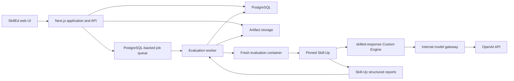

# Technical Architecture and Security

## System shape

SkillEd starts as a modular application with a separate evaluation worker, not
a collection of feature microservices.



## Intended application layout

```text
apps/
├── web/                         Next.js UI, API, auth, and GitHub workflows
└── worker/                      durable jobs and container orchestration
packages/
├── domain/                      shared types, policies, and metric formulas
├── skill-package/               scanning, parsing, validation, and manifests
├── skillup-adapter/             YAML materialization and report ingestion
└── response-runner/             no-tool Custom Engine executable
services/
└── model-gateway/               allowlisted model proxy and usage capture
skill-up/                        pinned internal upstream copy
```

Suggested implementation defaults are TypeScript, Next.js, PostgreSQL, a
PostgreSQL-backed durable queue, an S3-compatible artifact-store interface, and
Docker-compatible evaluation workers. Local development can use filesystem
artifacts while production uses object storage.

## Component responsibilities

### Web application

- GitHub login and SkillEd workspace authorization.
- Catalog, import, package inspection, test builder, run, and statistics UI.
- Typed API endpoints and input validation.
- GitHub App/API interaction for imports and later branch/PR publication.
- Enqueueing jobs; never running Skill-Up or Docker inside a request handler.

### Package service

- Safely unpack uploaded archives.
- Discover and parse `SKILL.md` files.
- Build checksummed package manifests.
- Apply Agent Skills structural validation and response-only warnings.
- Materialize an immutable run snapshot into the worker staging area.

### Worker

- Claim a queued job exactly once with retry-safe ownership.
- Verify referenced Skill and suite snapshot checksums.
- Create ephemeral working files and a fresh hardened container.
- Invoke the pinned Skill-Up binary using generated standard YAML plus an
  ephemeral runtime overlay.
- Stream bounded progress events.
- Ingest reports transactionally and upload raw artifacts.
- Guarantee container and staging cleanup on completion, error, timeout,
  cancellation, and worker restart recovery.

### Skill-Up adapter

- Translate supported test-domain objects to `eval.yaml` and case YAML.
- Select the `skilled-response` Custom Engine at runtime.
- Invoke Skill-Up as a process and capture exit status.
- Parse `result.json` and related benchmark artifacts into normalized results.
- Preserve unknown upstream fields in raw artifacts without making application
  logic depend on them.

It must not import `skill-up/internal/*`.

### Response runner

The local Custom Engine receives Skill-Up `SessionInput` and returns
`SessionResult`:

1. Validate the input and variant.
2. For `with_skill`, read the installed root `SKILL.md`, parse frontmatter, and
   construct the developer instruction from its metadata and Markdown body.
3. For `without_skill`, omit all Skill content.
4. Add the user test prompt unchanged.
5. Call the configured model with no tools.
6. Return final message, minimal transcript, token counts, duration, model, and
   exit code.

The runner cannot execute Skill scripts, follow file links, perform shell
commands, or accept arbitrary provider URLs.

### Model gateway

- Exposes only the model operation required by the response runner.
- Validates a short-lived signed run token bound to workspace, run ID, model,
  and expiry.
- Resolves the platform or encrypted workspace provider credential.
- Enforces model allowlist, token limit, timeout, and request-size limits.
- Rejects tool definitions and unsupported request fields.
- Records usage metadata and maps provider errors to stable categories.
- Does not log credential values; prompt/output logging follows workspace
  retention and redaction policy.

## Container boundary

The outer worker starts one fresh container per suite run. Skill-Up uses its
`none` runtime inside that container, avoiding nested Docker while still
providing per-run isolation.

Required controls:

- Image pinned by digest and prebuilt with Skill-Up and response runner.
- Non-root UID/GID.
- Read-only root filesystem.
- Dedicated writable workspace and bounded temporary filesystem.
- CPU, memory, process, file-size, and wall-clock limits.
- Dropped Linux capabilities and `no-new-privileges`.
- No privileged mode, host PID namespace, host filesystem bind, or Docker
  socket.
- Evaluation network is an internal bridge containing only the evaluation
  container and model gateway.
- The gateway has a separate outbound network; the evaluation container has no
  direct internet route.
- Run token rather than provider API key is injected into the container.
- Full cleanup is attempted and orphan containers are reconciled by a periodic
  worker task.

User content is data copied into the workspace, never a command line, image
name, setup step, environment-variable name, or network destination.

## Persistence

- PostgreSQL stores workspaces, authorization, catalog indexes, metadata,
  immutable snapshot identifiers, test definitions, normalized results,
  aggregates, job state, and audit records.
- Artifact storage holds immutable package snapshots and raw Skill-Up reports.
- Provider credentials are encrypted or stored in an external secret manager;
  only opaque references appear in application records.
- Search initially uses PostgreSQL full-text and trigram indexes; a separate
  search service is unnecessary.

## Reliability

- All run creation uses an idempotency key.
- A job lease heartbeat allows recovery after worker loss.
- Case result ingestion is upserted by run, case, variant, and iteration.
- Completion is published only after normalized results and artifact pointers
  commit successfully.
- Provider 429/5xx responses use bounded exponential retry; deterministic
  validation and assertion failures do not retry.
- A worker crash may retry a run attempt, but duplicate attempts remain visible
  and do not double-count final statistics.

## Observability

Application telemetry includes request and job IDs, run phase durations,
container startup/cleanup status, Skill-Up exit codes, ingestion failures,
model error categories, and queue depth. Prompts, outputs, Skill files, and
credentials are excluded from infrastructure logs by default.
