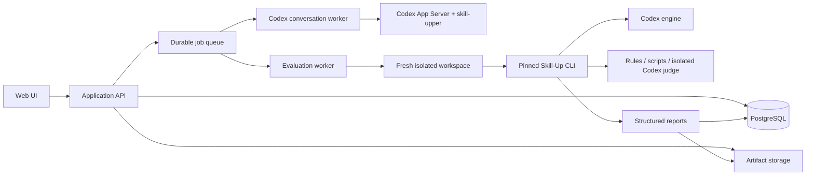

# V1 Technical Architecture and Security

## System shape

V1 is a modular application, not a fleet of feature microservices. Web/API,
worker processes, PostgreSQL, and an S3-compatible artifact interface are
separate responsibilities but may live in one private environment.

## Codex authentication

The private MVP uses one Codex CLI/App Server identity authenticated once on a
persistent worker. Its credential directory is encrypted, excluded from job
workspaces and artifacts, and treated as a secret. Jobs are serialized at
concurrency one. This is acceptable only for trusted users; per-user identity,
quota attribution, and public multi-tenancy are deferred.

## Conversation coordinator

The coordinator owns two durable user-facing purposes:

- `eval_authoring`: one thread per Skill version and eval draft.
- `upgrade_proposal`: one thread per base version and source run/proposal.

It starts/resumes Codex App Server threads, explicitly supplies the
`skill-upper` Skill, streams bounded events to persisted job events, handles
user-question pauses, and records structured outputs. It never treats Codex's
local thread store as the only source of truth; the database stores messages,
decisions, artifact references, and a reconstructable handoff summary.

## Context isolation

Four contexts must remain distinct:

1. Product conversation and user decisions.
2. Eval-authoring Codex thread.
3. Per-case tested Codex execution and separate semantic judge execution.
4. Upgrade-proposal Codex thread.

Test executions receive only the pinned case/runtime inputs. Judges receive the
rubric, allowed evidence, and produced result, not the tested agent's private
reasoning or authoring history. Upgrade agents see visible failure evidence but
not reserved holdout answers.

## Worker lifecycle

For every authoring, run, or proposal job the worker:

1. Claims a durable lease.
2. Fetches exact artifacts and verifies checksums.
3. Creates a fresh bounded workspace.
4. Materializes a normalized package and task/eval snapshot.
5. Executes the permitted Codex/Skill-Up operation.
6. Streams safe progress events.
7. Uploads outputs and raw structured reports.
8. Commits normalized records transactionally.
9. Cleans the workspace on every terminal path.

Skill-Up is invoked through its CLI. Product code does not import upstream
internal Go packages.

## Standard execution environment

The prebuilt pinned image contains Codex, Skill-Up, Python, Node.js, Git, and
approved libraries. It runs non-root with CPU, memory, process, file-size,
output, and wall-clock limits. Job data has one writable root; no Docker socket,
host filesystem, device, or sibling workspace is available. Codex itself may
read its protected credential store, but agent-executed tools must run inside a
process/filesystem sandbox that cannot read or copy that store.

Network is denied by default except the access required for Codex itself. User
packages cannot choose images, commands, environment variable names, secrets,
or network destinations. Live MCP and arbitrary dependency installation remain
disabled in V1.

Because V1 uses a shared logged-in Codex worker, it must initially remain a
private trusted-user system. Before public uploads, execution credentials must
be removed from the untrusted agent boundary using a supported per-user or
brokered authentication design.

## Eval authoring controls

Codex writes only to a draft workspace. The coordinator requires structured
artifacts for task understanding, questions, coverage plan, case manifest, and
proposal metadata. Generated YAML must pass `skill-up validate`; referenced
fixtures and scripts must remain within the snapshot and pass policy scanning.
Creating a snapshot or paid run requires an explicit API action by the user.

## Evaluation controls

Every run pins package, eval, task evidence, environment, Codex model/settings,
Skill-Up version, judge definitions, and iteration count. Retry transient
infrastructure failures only; assertion failures do not retry. Repeated trials
remain separate observations so flaky behavior is visible.

## Reliability and observability

- Idempotency keys protect mutations and run creation.
- Lease heartbeats recover abandoned jobs without double-counting attempts.
- Persisted events power SSE and post-restart status reconstruction.
- Raw `result.json` and related reports are the evidence source; normalized
  database rows are query projections.
- Logs include IDs, phases, durations, exit codes, and safe error categories,
  but exclude Skill contents, prompts, outputs, credentials, and environment
  dumps by default.
